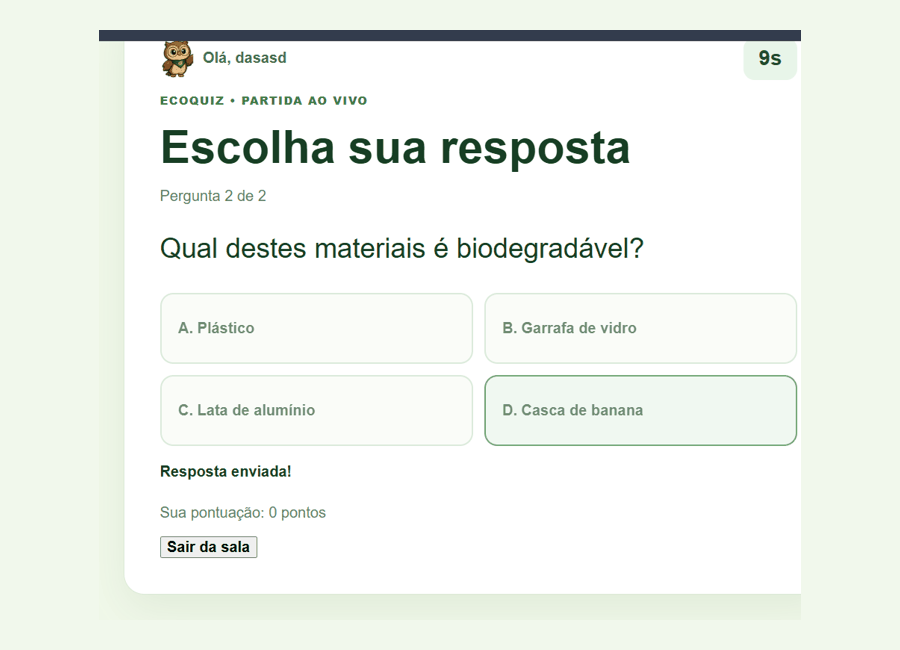
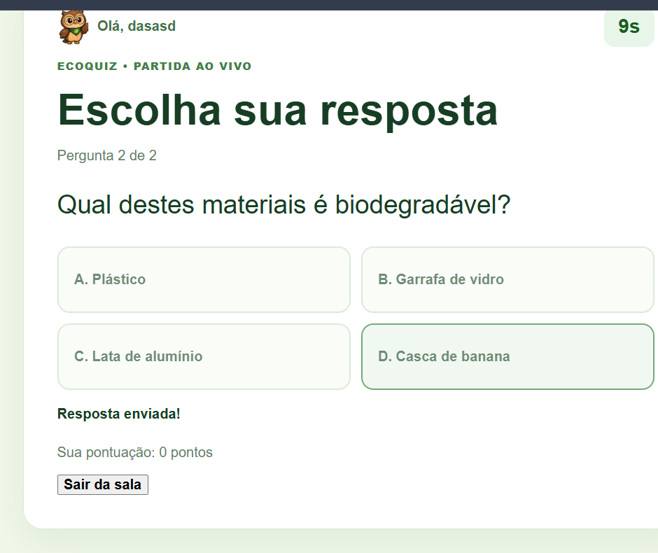
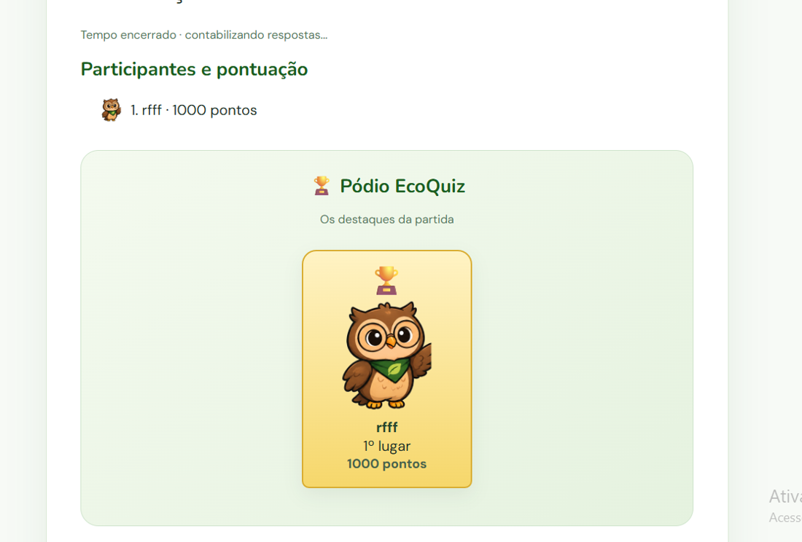

# 🌱 EcoQuiz ADM

**Um quiz educacional ao vivo sobre embalagens, materiais e sustentabilidade.**

O EcoQuiz ADM transforma atividades de revisão em uma partida interativa: a professora prepara as perguntas, abre uma sala com PIN e os participantes entram pelo navegador, escolhem um mascote e respondem em tempo real.

<p align="center">
  <a href="https://ecoquiz-adm.web.app"><strong>▶ Acessar o EcoQuiz</strong></a> ·
  <a href="https://github.com/rodriiguh4d/ecoquiz-adm"><strong>Repositório no GitHub</strong></a>
</p>

## Demonstração

<p align="center">
  
</p>

### Telas do projeto

| Partida do participante | Pódio final |
|---|---|
|  |  |

## Funcionalidades

- **Painel da professora:** acesso administrativo para gerenciar perguntas e organizar partidas.
- **Banco de perguntas:** cadastro de questões com alternativas em texto ou imagem.
- **Salas com PIN:** criação de uma sala e entrada dos participantes com código de seis dígitos.
- **QR Code:** acesso rápido à página de entrada, com o PIN da sala preenchido.
- **Participação sem cadastro:** os jogadores entram com apelido e escolhem um dos mascotes ilustrados.
- **Sincronização em tempo real:** sala, perguntas, participantes e pontuações são acompanhados pelo Firestore.
- **Tempo de resposta:** 10 segundos iniciais para leitura da pergunta, seguidos por 15 segundos para responder.
- **Pontuação por velocidade:** a pontuação começa em até 1.000 pontos e diminui conforme o tempo de resposta.
- **Resultado da partida:** classificação e pódio com os destaques da rodada.

## Tecnologias

- **HTML5** para a estrutura das páginas.
- **CSS3** para layout, responsividade e identidade visual.
- **JavaScript (ES Modules)** para a lógica do jogo e interações.
- **Firebase Authentication** para autenticação administrativa e acesso anônimo dos participantes.
- **Cloud Firestore** para perguntas, salas, participantes, respostas e pontuação em tempo real.
- **Firebase Hosting** para publicação do site.

## Como executar localmente

1. Faça o download ou clone este repositório.
2. Abra a pasta do projeto no Visual Studio Code.
3. Inicie um servidor local (por exemplo, com a extensão Live Server).
4. Abra `index.html` pelo servidor local. Evite abrir o arquivo diretamente pelo sistema de arquivos, pois o projeto utiliza módulos JavaScript.
5. Para usar os recursos conectados, configure um projeto Firebase e confira `firebase.js`, `firebase.json` e `firestore.rules`.

> **Atenção:** a configuração do Firebase incluída no cliente identifica o projeto, mas não substitui as regras de segurança. Revise e publique as regras do Firestore antes de usar uma instância própria. Nunca coloque senhas, tokens privados ou credenciais de servidor no código do navegador.

## Estrutura principal

```text
.
├── assets/
│   ├── personagens/       # Mascotes dos participantes
│   └── screenshots/       # Imagens e GIF da demonstração
├── professora/            # Painel e sala da professora
├── index.html             # Entrada do participante
├── script.js              # Entrada, PIN e seleção de mascote
├── sala.html              # Interface da partida
├── sala.js                # Sincronização e respostas do participante
├── firebase.js            # Inicialização do Firebase
├── firestore.rules        # Regras de acesso do Firestore
└── firebase.json          # Configuração do Hosting
```

## Documentação

- [Guia de uso](docs/GUIA-DE-USO.md)
- [Tecnologias e arquitetura](docs/TECNOLOGIAS-E-ARQUITETURA.md)
- [Imagens e demonstração](docs/DEMONSTRACAO.md)

## Status

Projeto funcional publicado no Firebase Hosting. A validação com múltiplos participantes simultâneos continua sendo uma etapa importante de testes.

## Contexto acadêmico

Projeto desenvolvido como atividade prática relacionada à área de Sistemas de Informação, com foco em desenvolvimento web, integração com serviços em nuvem e aprendizagem interativa sobre sustentabilidade.

---

<p align="center">Feito com 🌱 para aprender, ensinar e jogar.</p>
